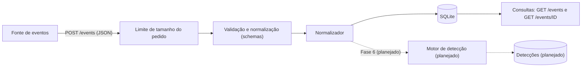

# Arquitetura

Como o Vigil SIEM está organizado, como um evento percorre o sistema e por que o projeto foi desenhado assim. Este documento descreve o que existe hoje. O que é planejado aparece marcado como tal.

## Visão geral

O Vigil SIEM é um **monólito modular**: uma única aplicação (backend em Python com FastAPI) dividida em módulos com responsabilidades claras. Não há microsserviços, filas nem serviços externos. Tudo roda no computador do desenvolvedor, com um banco SQLite em arquivo, o que mantém o custo em zero.

A organização foi pensada para crescer por módulos (detecção, correlação, alertas) sem reescrever o que já existe.

## Fluxo de um evento

O diagrama mostra o caminho que um evento percorre. As linhas tracejadas são o que está **planejado** (Fase 6).

### Passo a passo do `POST /events`

1. **Limite de tamanho** (`core/limits.py`): um pedido com corpo maior que o limite (256 KiB por padrão) recebe 413 sem ser processado. A conferência vale mesmo que o cliente não declare o tamanho.
2. **Validação** (`schemas/event.py`): o corpo é lido como JSON e conferido contra o `EventCreate`. Qualquer problema vira uma resposta 422, montada em `core/errors.py` sem repetir o texto enviado. Campos opcionais já saem na forma padrão (horário em UTC, IP escrito de forma canônica, gravidade em minúsculas).
3. **Corpo original** (`api/events.py`, `get_raw_body`): a dependência entrega os bytes exatamente como chegaram.
4. **Sessão de banco** (`database/session.py`, `get_db`): uma sessão exclusiva do pedido, fechada no fim mesmo em caso de erro.
5. **Normalização** (`processing/normalizer.py`): monta o registro do banco com os campos validados e guarda o corpo original em `raw_event`. Não inventa valores e não preenche `id` nem `received_at`.
6. **Gravação**: o endpoint faz o `commit`. É o momento em que o evento passa a existir.
7. **Resposta**: 201 com o evento no formato `EventRead`, que não inclui o `raw_event`.

### Consultas

- `GET /events`: lista do mais novo para o mais antigo, com `limit` e `offset`. Não devolve o `raw_event`.
- `GET /events/{event_id}`: um evento, com o `raw_event`. Responde 404 se não existir.

## Estrutura do backend

| Caminho | Responsabilidade | Situação |
|---|---|---|
| `backend/app/main.py` | Monta a aplicação: middleware de tamanho, tratamento de erros e registro dos endpoints | Implementado |
| `backend/app/api/` | Endpoints HTTP (`events.py`) | Implementado |
| `backend/app/schemas/` | Formato dos dados de entrada e saída, com as regras de validação e de forma padrão dos campos | Implementado |
| `backend/app/processing/` | Normalizador: monta o registro do banco e guarda o original recebido | Implementado |
| `backend/app/models/` | Tabelas do banco (SQLAlchemy) | Implementado |
| `backend/app/database/` | Classe base dos modelos, engine, sessões, `get_db()` e `init_db()` | Implementado |
| `backend/app/core/` | Configuração (`config.py`), limite de tamanho (`limits.py`) e formato dos erros 422 (`errors.py`) | Implementado |
| `backend/alembic/` | Migrações do banco | Implementado |
| `backend/tests/` | Testes automatizados | Implementado |
| `backend/app/detection/` | Motor de detecção e regras | Planejado (Fase 6), ainda não existe |
| `backend/app/correlation/` | Correlação de eventos | Planejado (Fase 7), ainda não existe |
| `scripts/` | Geradores de eventos para laboratório | Planejado (Fase 6), ainda não existe |
| `frontend/` | Interface web | Planejado (Fase 9), ainda não existe |

## Regras de dependência

As dependências entre as pastas vão em **uma só direção**:

- `core/` não importa nenhuma outra pasta do projeto.
- `schemas/` usa só bibliotecas externas (Pydantic) e a biblioteca padrão do Python. Não conhece o banco.
- `models/` conhece só `database/base.py`.
- `database/` usa `core/` (para ler a configuração) e os modelos.
- `processing/` junta `schemas/` e `models/`.
- `api/` usa todas as anteriores. Só o `main.py` importa o `api/`.

Isso evita importações circulares e permite testar cada camada sozinha: os schemas são testados sem banco, e o normalizador sem servidor.

## Decisões de projeto

| Decisão | Motivo |
|---|---|
| A validação e a forma padrão dos campos ficam nos schemas | Todo dado é conferido na fronteira, antes de qualquer outra parte do sistema tocá-lo. O normalizador fica simples |
| Estrito na entrada, tolerante na leitura | A API só grava dados válidos. Mas uma linha inesperada no banco (por exemplo, editada à mão) não derruba a listagem |
| O original (`raw_event`) é guardado exatamente como chegou | Serve de evidência para investigação. Fica fora das listas porque pode ser grande |
| `id`, `received_at` e `raw_event` são gerados pelo servidor | Quem envia o evento não pode forjar a hora em que ele chegou nem o original guardado |
| O `commit` é feito pelo endpoint, e não pela dependência de sessão | Deixa explícito, no código do endpoint, o momento em que o evento passa a existir |
| Eventos não podem ser alterados nem apagados pela API | Os registros são evidência. Não existem rotas `PUT`, `PATCH` nem `DELETE` |
| Horários sempre em UTC | Elimina ambiguidade de fuso. O SQLite não guarda o fuso, então o schema de saída o restaura |
| O esquema do banco é criado por migrações, e não por `create_all` | Permite evoluir o banco sem perder dados, com histórico e como desfazer |
| Sem índices além da chave primária | Um índice só vale para uma consulta que existe. Serão criados, com medição, quando a detecção e a investigação os exigirem |
| Os erros 422 não repetem o texto enviado | Evita devolver texto hostil ao cliente e respostas enormes |

## Fronteira de confiança

Tudo que chega pela rede é **tratado como não confiável**: o corpo dos pedidos e os parâmetros da URL. A fronteira é formada pelo middleware de tamanho e pelos schemas. O que passa por eles já está validado e em forma padrão. As respostas são sempre JSON, e quem exibir os dados (como o frontend futuro) precisa escapá-los. As proteções e as limitações conhecidas estão em [SECURITY.md](../SECURITY.md).

## Evolução planejada

Nada desta seção existe ainda.

- **Fase 6, motor de detecção:** depois do `commit` do evento, regras são executadas de forma isolada (uma regra com defeito não pode afetar a ingestão) e gravam **detecções**, ligadas aos eventos que as provam. As janelas de tempo usam o `received_at`.
- **Fase 7, correlação:** agrupa detecções e eventos relacionados.
- **Fase 8, alertas:** estados (aberto, em investigação, resolvido, falso positivo) e histórico.
- **Fase 9, frontend:** painel e investigação.
- **Fase 11, autenticação e auditoria.**
- **Fase 13, Docker.**

O estado detalhado do desenvolvimento está em [PROJECT_STATE.md](PROJECT_STATE.md).